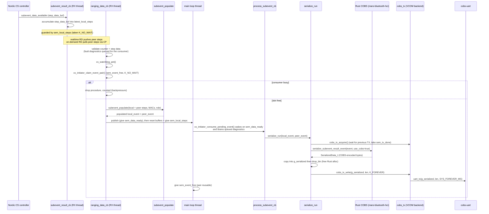
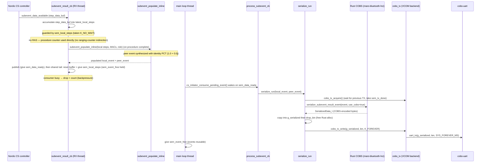

# Architecture

This is a code-derived contributor overview of the mars-cs-nrf54lm firmware —
the module layout, the ranging-data flow, the initiator main loop, and the
configuration layer. To build, see
[docs/build-from-source.md](build-from-source.md); to flash prebuilt firmware,
see [docs/flash-quickstart.md](flash-quickstart.md); for board overlays, UARTs,
and antenna/path presets, see [docs/hardware.md](hardware.md).

This document describes how the firmware is built and how ranging data moves
through it. It does **not** introduce Channel Sounding technology itself — see
the [Bluetooth SIG Channel Sounding overview](https://www.bluetooth.com/channel-sounding-tech-overview/)
for that — and it does **not** reproduce the COBS wire format or the
`mars-bluetooth-hci` API (see the [mars-bluetooth-hci](https://github.com/Metirionic/mars-bluetooth-hci)
repo) or the preset/board table (see [docs/hardware.md](hardware.md)).

## Module map

Two firmware roles plus a shared library:

| Target | Role | Description | Build file |
|--------|------|-------------|------------|
| `initiator` | BLE Central / CS initiator | Scans for a CS reflector, connects, runs CS procedures, collects ranging data, and outputs COBS-encoded binary over UART | `initiator/CMakeLists.txt` |
| `reflector` | BLE Peripheral / CS reflector | Advertises the Ranging Service, accepts one connection, and answers CS procedures. Emits no COBS stream. | `reflector/CMakeLists.txt` |
| `common` | shared library | The `cs_common` static lib (linked by the initiator) plus selected files pulled in directly by each app | `common/CMakeLists.txt` |

### initiator

`initiator/src/`:

| File | Purpose (`@brief`) |
|------|---------------------|
| `main.c` | "Channel Sounding initiator with ranging requester sample" — app entry: registers the consumer-thread callback `process_subevent_cb` for both modes, the RAS-only `process_log_cb`, and the RAS `ranging_data_cb` / `ranging_data_ready_cb`, builds the `cs_initiator_config`, calls `cs_initiator_start`, and runs the consumer loop. `main()` at `initiator/src/main.c:279`. |
| `serialize.c` | "Channel Sounding data serializer" — parses local + peer step data into `SubeventResultEvent_t`, calls the Rust COBS serializer, and hands each complete serialization run to the COBS TX seam. |
| `serialize.h` | Prototypes for `serialize_run` and `serialize_send_log_message`. |
| `cobs_tx.h` | Transport-neutral COBS TX seam: acquire the run buffer, submit one complete run, release a run that was not submitted. `COBS_TX_RUN_MAX_SIZE` is the largest run the seam accepts. |
| `cobs_tx_vcom.c` | VCOM COBS TX backend (built when `CONFIG_MARS_CS_TRANSPORT_USB` is off) — owns the `cobs-uart` device, the asynchronous `uart_tx` submission, and the `sem_tx_done` TX-done gate. |
| `cobs_tx_usb.c` | USB COBS TX backend (built when `CONFIG_MARS_CS_TRANSPORT_USB` is on) — owns the CDC ACM data UART (chosen `cobs-uart`), a `COBS_TX_RUN_MAX_SIZE` full-run ring, and the IRQ-callback drain into the driver with `uart_fifo_fill`; `sem_tx_free` gates the run path. |

`initiator/CMakeLists.txt`:

- Fetches the Rust crate `mars-bluetooth-hci@0.13.2` via CMake `FetchContent` (`:6-11`).
- Builds the shared `common` library as `cs_common` via `add_subdirectory(../common cs_common)` (`:22`).
- Compiles `src/main.c`, `src/serialize.c`, `common/rust_callbacks.c`, and exactly one COBS TX backend straight into `app` (`:24-34`): `src/cobs_tx_vcom.c` for VCOM builds, `src/cobs_tx_usb.c` when `CONFIG_MARS_CS_TRANSPORT_USB` is enabled. VCOM builds therefore compile no USB code, and USB builds compile no VCOM backend.
- Links `cs_common` (`:27`) and the Rust static archive (`:31-32`); exposes the generated Rust header to `cs_common` (`:28-29`).

### reflector

`reflector/src/`:

| File | Purpose (`@brief`) |
|------|---------------------|
| `main.c` | "Channel Sounding Reflector with Ranging Responder sample" — advertises (the Ranging Service UUID in RAS, or its device name in IPT), accepts one connection, and configures the CS reflector role; in RAS it also sets procedure parameters (in IPT the reflector is passive and sets none). `main()` at `reflector/src/main.c:319`. |

`reflector/CMakeLists.txt`:

- No `FetchContent`, no Rust, no `mars-bluetooth-hci-rust` — the reflector never serializes.
- Pulls only `src/main.c`, `common/antenna.c`, and `common/cs_watchdog.c` directly into `app` (`:9-11`), plus `common/mars_usb.c` for native USB builds (`:13-17`). It does **not** link `cs_common`.

### shared `common` library

`common/CMakeLists.txt` builds it as the `cs_common` static library
(`antenna.c ble_callbacks.c ble_scanning.c cs_initiator.c cs_step_parse.c cs_watchdog.c subevent.c addr_utils.c`,
`:4-13`), plus `mars_usb.c` for native USB builds only (`:15-19`), with
`zephyr_interface` linked PRIVATE so the lib can use Zephyr
headers without pulling the full Zephyr target (`:22`).

**The `common` code is shared two different ways — call this out, it is not symmetric:**

- The **initiator** links `cs_common` *and* additionally compiles `common/rust_callbacks.c` straight into `app`.
- The **reflector** does **not** link `cs_common` at all — it compiles only `common/antenna.c` and `common/cs_watchdog.c` into its `app` (plus `common/mars_usb.c` in native USB builds). It needs just the antenna lookups, the liveness watchdog, and the USB console bring-up, none of the initiator-side CS/RAS machinery.

`common/` source files:

| File | Purpose (`@brief`) |
|------|---------------------|
| `addr_utils.{c,h}` | "Shared BLE address utility functions" — `addr_to_u64()` packs a `bt_addr_le_t` into a `uint64_t`. |
| `antenna.{c,h}` | "Antenna configuration lookup tables for Channel Sounding" — `get_antenna_config()` / `get_preferred_peer_antenna()` map the Kconfig antenna/path counts to a CS tone-antenna config and a preferred-peer bitmask. |
| `ble_callbacks.{c,h}` | "Shared BLE connection and Channel Sounding callbacks" — owns the `BT_CONN_CB_DEFINE(conn_cb)` connection-callback table and the connection ref for the initiator; forwards CS subevent-data and config-created events to registered user callbacks; gives five of the setup semaphores. |
| `ble_scanning.{c,h}` | "BLE scanning and Ranging Service UUID filtering" — `scan_init()` configures `bt_scan` with `connect_if_match` and a filter that selects the peer by **Ranging Service UUID** (RAS) or by **advertised name** (IPT — the reflector does not advertise that UUID, so the initiator matches `CONFIG_BT_DEVICE_NAME` instead). |
| `cs_initiator.{c,h}` | "Shared Channel Sounding initiator connection and configuration flow" — the heart of the initiator: all setup semaphores, the step-data net buffers, the RAS feature bits, the MACs, and `cs_initiator_start()` which runs the full setup handshake; also defines the local `subevent_result_cb`. |
| `cs_step_parse.{c,h}` | "Shared CS step data parsing into SubeventResultEvent structures" — `cs_step_parse()` (RAS) converts local + peer HCI Mode-2 step records into the Rust FFI `SubeventResultEvent_t` / `Step_t` / `Mode2_t` fields; also populates the Mode-0 calibration steps (kind per role from the step `data_len`, measured frequency offset passed through raw); `cs_step_parse_inline()` (IPT) parses the local steps only and synthesizes the peer event per step with a transparent identity (1.0 + 0.0j) Phase Correction Term for Mode-2 and a zeroed `MODE0_REFLECTOR` step for Mode-0, so the downstream combiner sees a structurally valid `ORIGIN_REFLECTOR` event with a no-op phase rotation. |
| `cs_watchdog.{c,h}` | "CS liveness watchdog" — the #116 recovery mechanism: a timer pets only on completed procedures with step data (initiator) or completed subevents with steps (reflector); on timeout it invokes the registered recovery callback (both apps force a disconnect that reboots the pair). Built into `cs_common` for the initiator and compiled directly into the reflector `app`, so both roles run it. |
| `mars_usb.{c,h}` | "Shared native USB bring-up module" — the single USB device context, string descriptors (product/PID by role, SoC-derived serial), full-speed and high-speed configurations, CDC ACM class registration, VBUS policy, and `mars_usb_init()`. Compiled into `cs_common` (initiator) and directly into the reflector `app` only when `CONFIG_MARS_CS_TRANSPORT_USB` is enabled. |
| `subevent.{c,h}` | "CS subevent data parsing into SubeventResultEvent structures" — `subevent_populate()` (RAS) fills the initiator + reflector events from both the local and peer step buffers via `cs_step_parse()`; `subevent_populate_inline()` (IPT) fills them from the local step buffer only via `cs_step_parse_inline()` (the reflector's phase contribution is embedded in the local tones, so there is no peer buffer). Both seed the shared header through `fill_subevent_header()`. |
| `rust_callbacks.c` | "Shared Rust FFI callback implementations" — the C functions the Rust runtime calls back into (`rust_panic_cb`, `rust_print_cb`). Compiled into the initiator `app` only. |

## The Rust COBS-serializer bridge

The initiator uses [mars-bluetooth-hci](https://github.com/Metirionic/mars-bluetooth-hci)
for COBS serialization. The reflector does not. This section describes how the
crate is fetched, built for the ARM target, and linked — the COBS wire format
itself lives in that external repo and is not reproduced here.

**Fetch.** The crate is fetched by CMake `FetchContent` in
`initiator/CMakeLists.txt:6-11` (`GIT_REPOSITORY …/mars-bluetooth-hci.git`,
`GIT_TAG mars-bluetooth-hci@0.13.2`), then `FetchContent_MakeAvailable`. It is
**not** a west project — `west.yml` fetches only NCS — and **not** a submodule. A
clean build clones it from GitHub at CMake-configure time (network needed on the
first configure; cached under `build/.../_deps` afterward).
`MARS_BT_HCI_RUST_DIR` is set to the inner crate dir (`:13`) and added to
`CMAKE_PREFIX_PATH` (`:16`) for `find_package(mars-bluetooth-hci-rust)` (`:17`).

**ARM build.** The crate's `mars-bluetooth-hci-rust-config.cmake` runs
`cargo build --lib --target thumbv8m.main-none-eabihf --release` as the
`build_mars_bt_hci_rust` custom target (`RUST_TARGET` is set at
`initiator/CMakeLists.txt:14`). For the firmware build the crate is built with
`--no-default-features --features libc,alloc,libc-panic,libc-alloc`, producing
`libmars_bluetooth_hci.a`.

**Linking.** `add_dependencies(app build_mars_bt_hci_rust)` makes the firmware
build wait on the cargo build, and
`target_link_libraries(app PRIVATE ${MARS_BT_HCI_RUST_LINK_LIBRARIES})` links the
imported static archive (`initiator/CMakeLists.txt:31-32`). The generated C header
reaches the C code through
`target_include_directories(cs_common PUBLIC ${MARS_BT_HCI_RUST_INCLUDE_DIRECTORIES})`
(`:28-29`).

**C → Rust entry points (live).** The firmware calls three Rust functions
declared in the generated `mars_bluetooth_hci.h` (auto-generated by `::safer_ffi`,
not `cbindgen`):

- `serialize_subevent_result_event(event, use_cobs)` — called with `use_cobs=true` at `initiator/src/serialize.c:94` (inside `serialize_append_event`).
- `serialize_log_message(msg, use_cobs)` — called with `use_cobs=true` at `initiator/src/serialize.c:74` (inside `serialize_append_log_message`).
- `drop_bin(SerializedData_t)` — frees the Rust allocation, called after each copy at `initiator/src/serialize.c:79,83,99,103`.

(The generated header also exports `new_dummy_data`, but the firmware does not call it.)

**Rust → C callbacks (by link-time symbol, no runtime registration).** The Rust
runtime calls back into C by symbol linkage:

- `rust_panic_cb` — defined at `common/rust_callbacks.c:22`, declared and used by the Rust `#[panic_handler]`.
- `malloc` / `free` — the Rust `#[global_allocator]` links against newlib, enabled by `CONFIG_NEWLIB_LIBC=y` (`initiator/prj.conf:32`).

(`rust_eh_personality` is exported by Rust for the linker's exception-handling support and is not called from C.)

_See [mars-bluetooth-hci](https://github.com/Metirionic/mars-bluetooth-hci) for
the wire format and the full FFI surface — they are not reproduced here._

## Ranging-data flow

The firmware has two ranging modes, selected at build time by
`CONFIG_MARS_CS_INLINE_PCT` (`common/Kconfig`):

- **RAS** (Ranging Service) — the initiator pulls the peer's step data over a
  GATT Ranging Service and combines it with its own.
- **IPT** (inline Phase Correction Term) — the reflector's phase contribution is
  embedded in the local tones, so the initiator uses its own step data only and
  there is no RAS GATT path.

Both modes converge on the same output: a `SubeventResultEvent_t` pair is
populated, then `serialize_run()` COBS-encodes it via the Rust FFI and hands the
complete run to the transport-neutral COBS TX seam. The build-selected backend
of that seam is the only code that touches the `cobs-uart` device:
`cobs_tx_vcom.c` submits with asynchronous `uart_tx` for VCOM builds, while
`cobs_tx_usb.c` copies the run into a full-run ring that its CDC ACM IRQ
callback drains with `uart_fifo_fill` for native USB builds. The wire format is
the same `mars-bluetooth-hci` output either way (there is no separate
host-decoder story for IPT). The modes differ only in
the **acquisition** half — how the step data is gathered and when the events are
populated. RAS is *peer-data-driven* (serialization waits for the peer's RAS
ranging data to arrive); IPT is *local-data-driven* (serialization runs as soon as
the local procedure completes).

### RAS path

End-to-end on the initiator:

1. **CS procedure configured and started.** `cs_initiator_start()`
   (`common/cs_initiator.c:572`) runs a linear setup handshake, each step paced by
   a semaphore (see the next section): scan (Ranging Service UUID filter) → connect
   → security → MTU exchange → GATT discovery of the Ranging Service → read RAS
   feature bits → exchange CS capabilities → create the CS config
   (`BT_CONN_LE_CS_MAIN_MODE_2_NO_SUB_MODE`, role `BT_CONN_LE_CS_ROLE_INITIATOR`,
   `BT_CONN_LE_CS_RTT_TYPE_AA_ONLY`, `BT_CONN_LE_CS_CHSEL_TYPE_3B`) → enable CS
   security → set procedure parameters (using `get_antenna_config()` /
   `get_preferred_peer_antenna()`) → enable CS procedures. After it returns,
   procedures run autonomously in the controller.

2. **RAS receive.** Two receive modes, selected from the peer's RAS feature bits
   (`bt_ras_rreq_read_features` → `ras_feature_bits`, set in `ras_features_read_cb`
   at `common/cs_initiator.c:350`; the read is issued at `:648`):

   - **Realtime RD** — `bt_ras_rreq_realtime_rd_subscribe(conn, &latest_peer_steps, ranging_data_cb)`
     (`common/cs_initiator.c:661`): the peer's ranging data is pushed straight to `ranging_data_cb`.
   - **On-demand RD** — subscribe to overwritten / ready / on-demand / CP
     notifications (`common/cs_initiator.c:670-691`); when the peer signals "ready",
     `ranging_data_ready_cb` pulls the peer data with
     `bt_ras_rreq_cp_get_ranging_data(conn, &latest_peer_steps, counter, ranging_data_cb)`
     (`initiator/src/main.c:204-207`), and `ranging_data_cb` fires on completion.

   The **local** side's CS subevent data arrives through the BLE connection
   callback `.le_cs_subevent_data_available` → `subevent_data_available_cb`
   (`common/ble_callbacks.c:89`) → `subevent_result_cb`
   (`common/cs_initiator.c:367`), which accumulates `result->step_data_buf` into
   the `latest_local_steps` net buffer.

3. **Populate and hand off.** `ranging_data_cb` (`initiator/src/main.c:86-195`)
   validates the peer ranging counter against the local one, drops on mismatch or
   on an all-aborted procedure (queueing the diagnostic frame with
   `cs_initiator_queue_log_message()`), and — on the healthy path — pets the CS
   liveness watchdog on the RX thread (`initiator/src/main.c:162`). The pet
   trigger is unchanged (a completed procedure with step data), but because the
   blocking TX no longer runs on this thread, a stalled consumer shows up as
   procedures dropped at the handoff gate (counted) rather than suppressed pets.
   It then claims the shared
   RX-thread → consumer-thread handoff slot with
   `cs_initiator_claim_event_pair()` (`common/cs_initiator.c:203`). A failed
   claim means the consumer is still serializing the previous item: the
   procedure is dropped and counted (`report_backlog_drop()`,
   `common/cs_initiator.c:195`), the same backpressure valve IPT uses. On
   success it calls
   `subevent_populate(...)` (`initiator/src/main.c:173-180`) —
   `subevent_populate()` (`common/subevent.c:77`) fills both event headers via
   `fill_subevent_header()` and hands the local + peer step buffers to
   `cs_step_parse()`, which fills the `steps[]` arrays — then publishes with
   `cs_initiator_publish_event_pair()` (`initiator/src/main.c:182`,
   `common/cs_initiator.c:220`), resets the net buffers, and gives
   `sem_local_steps` (`initiator/src/main.c:194`). **No serialize or transmit
   work runs in this RX callback.** `cs_config.role` was saved earlier by
   `config_create_hook` (`initiator/src/main.c:220`).

4. **Serialize + COBS over the TX seam (main loop thread).** The main loop calls
   `cs_initiator_consume_pending_event()` (`initiator/src/main.c:356`, defined at
   `common/cs_initiator.c:263`), which waits on `sem_data_ready`, drains any
   queued diagnostic frames (each via `process_log_cb` →
   `serialize_send_log_message()`), runs the app's `process_subevent_cb` →
   `serialize_run()` on the **main loop thread** for a pending event pair, then
   releases `sem_event_free`. RAS does not pet the watchdog here — its pet stays
   on the RX-thread completion signal above (IPT pets in
   `process_subevent_cb`, at the consume rate). `serialize_run()`
   (`initiator/src/serialize.c:162-238`)
   acquires the run path via `cobs_tx_acquire()` — the VCOM backend takes the
   `sem_tx_done` TX-complete gate there, while the USB backend takes
   `sem_tx_free` and gives it back when its full-run ring has been handed to
   the CDC ACM driver — then `serialize_append_event()`
   calls `serialize_subevent_result_event(p_event, true)` (Rust FFI, COBS on,
   `:94`) for each of the local and peer events; the returned `SerializedData_t` is
   copied into the static `g_serialized[]` buffer by `serialize_cb()` and freed
   with `drop_bin()`, followed by a `serialize_log_message("Processing finished")`.
   Finally `cobs_tx_write(g_serialized, g_total_written_size, K_FOREVER)` (`:219`)
   hands the whole run to the build-selected backend. VCOM builds submit it with
   `uart_tx(...)` (`initiator/src/cobs_tx_vcom.c:112`); USB builds copy the run
   atomically into `cobs_usb_tx_ring` and drain it from the CDC ACM IRQ callback
   with `uart_fifo_fill` (`initiator/src/cobs_tx_usb.c`). The VCOM backend
   acquires the UART device once at init:
   `gp_cobs_uart_dev = DEVICE_DT_GET(DT_CHOSEN(cobs_uart))`
   (`cobs_tx_vcom.c:19`); the USB backend resolves the same chosen node to its
   CDC ACM data UART. The async UART API is enabled
   (`CONFIG_UART_ASYNC_API=y`, `initiator/prj.conf:26`);
   `g_serialized` is `29000` bytes (`COBS_TX_RUN_MAX_SIZE`, `serialize.c:37,43`).



The populate runs on the **RX thread** but the serialize + submit runs on the
**main loop thread** — the same split IPT uses. There is no ring buffer,
`k_work`, or `k_fifo` between the callback and the UART: the event handoff is
the one static event pair guarded by `sem_event_free` / `sem_data_ready`, and
RAS fault diagnostics travel in a small separate `K_MSGQ` drained on the same
consumer wake. `sem_local_steps` remains the binary lock guarding the step-data
net buffers between the producer (`subevent_result_cb`) and the consumer
(`ranging_data_cb`); see the next section.

### IPT path

IPT (`CONFIG_MARS_CS_INLINE_PCT=y`) drops the RAS GATT path entirely: the
reflector's phase contribution is embedded in the local tones, so the initiator
never reads peer step data. The reflector is passive — it advertises only its
device name (no Ranging Service UUID) and lets the initiator drive all of the CS
setup.

1. **CS procedure configured and started.** `cs_initiator_start()` runs the same
   handshake, but the RAS-specific steps — MTU exchange, GATT discovery of the
   Ranging Service, and the RAS feature read + subscribe — are compiled out
   (`#if !IS_ENABLED(CONFIG_MARS_CS_INLINE_PCT)`, `common/cs_initiator.c:616-630`
   and `:646-698`). The CS config is created with
   `BT_CONN_LE_CS_MAIN_MODE_2_NO_SUB_MODE` (`:711`) and `cs_enhancements_1 = 1`
   (`:725`) to enable inline PCT transfer; `scan_init()` matches the reflector's
   advertised name, not the Ranging Service UUID (`common/ble_scanning.c:86-98`).

2. **Local-only acquisition.** The local CS subevent data arrives the same way —
   `.le_cs_subevent_data_available` → `subevent_data_available_cb`
   (`common/ble_callbacks.c:89`) → `subevent_result_cb`
   (`common/cs_initiator.c:367`), which accumulates `result->step_data_buf` into
   `latest_local_steps` (guarded by `sem_local_steps`, taken `K_NO_WAIT` at
   `:385`). There is no RAS ranging-counter indirection: the procedure counter is
   used directly (`procedure_ranging_counter = result->header.procedure_counter`,
   `:378`), and there is no `latest_peer_steps` buffer.

3. **Populate and hand off.** On procedure complete
   (`BT_CONN_LE_CS_PROCEDURE_COMPLETE`), `subevent_result_cb` claims the shared
   handoff slot with `cs_initiator_claim_event_pair()` and calls
   `subevent_populate_inline(p_local_event, p_peer_event, g_local_mac, g_peer_mac, &g_latest_subevent_header, &latest_local_steps, BT_CONN_LE_CS_ROLE_INITIATOR)`
   (`common/cs_initiator.c:464-472`).
   `subevent_populate_inline()` (`common/subevent.c:119`) fills both
   event headers and, via `cs_step_parse_inline()`, parses the **local** steps only
   — the peer (reflector) event is synthesized per step with a transparent identity
   (1.0 + 0.0j) Phase Correction Term, so the downstream combiner sees a structurally
   valid `ORIGIN_REFLECTOR` event with a no-op phase rotation. The skeleton then
   releases the step buffer and hands the populated event pair to the consumer
   thread through the `sem_event_free` / `sem_data_ready` handshake (below),
   which RAS uses as well. The cascade decides only the differing part; the
   shared tail after it (`common/cs_initiator.c:476-477`) resets the net buffer
   and returns the `sem_local_steps` token once for every outcome. Three cases:
   - **Empty procedure** (`latest_local_steps.len == 0`, `:453-456`): LOG_WRN
     only — do **not** wake the consumer (nothing to consume), so the warning
     log is the only trace; the shared tail still recovers `sem_local_steps`.
   - **Consumer busy** (`sem_event_free` held — the main loop is still
     serializing the previous event pair, `:462-463`, claim inside
     `cs_initiator_claim_event_pair()` at `:203-218`): drop the procedure,
     counted in `g_event_backlog_drops` (LOG_WRN on the first drop and every
     128th). This is the deliberate backpressure valve; see the threading note
     below.
   - **Otherwise** (`:464-473`): populate, publish with
     `cs_initiator_publish_event_pair()` (give `sem_data_ready`). An aborted
     procedure resets the buffer and does **not** wake the consumer
     (`common/cs_initiator.c:480-490`), mirroring the RAS error path.

4. **Serialize + COBS over the TX seam (main loop thread).** The main loop calls
   `cs_initiator_consume_pending_event()` (`initiator/src/main.c:356`, defined at
   `common/cs_initiator.c:263-288`), which waits on `sem_data_ready` (`:265`),
   drains any queued diagnostics, runs the app's `process_subevent_cb` →
   `cs_watchdog_pet()` + `serialize_run()` on the **main loop thread**, then
   releases `sem_event_free` (`:286`). Same wire format, same
   `mars-bluetooth-hci` output as RAS; there is no separate host-decoder story.



The populate runs on the **RX thread** but the serialize + UART write runs on the
**main loop thread** — the deliberate split that fixes #173, and the same one
the RAS path uses (above). One ~26.6 KB COBS
event takes ~289 ms to DMA out at 921600 baud (≈3.5 events/s wire limit) — the
timing is baud-dependent, and the nRF54LM20-DK's 1,000,000 baud is
proportionally faster. Run that inline in the RX thread and the HCI step-data
delivery backs up, the SDC aborts the surplus subevents, and the procedures
complete empty (the #173 symptom: ~70 % empty completions at
`procedure_interval = 1`). With the handoff, the SDC runs every procedure at
the full cadence and surplus events drop at the `sem_event_free` gate instead —
visibly, with a counted warning. The wire rate still caps the output
(≈3.5 events/s at 921600 baud); raising the procedure cadence above that
increases the drop rate, it does not lose data silently.
`sem_local_steps` still guards `latest_local_steps` between the accumulator and
the populate (same-thread now, but the lock also paces procedure-to-procedure);
the app's `process_subevent_cb` (watchdog pet + serialize) runs on the main loop
thread via `cs_initiator_consume_pending_event()`.

## Semaphore-driven initiator main loop

There are eleven `k_sem` instances in `common/cs_initiator.c` in a RAS build —
eight unconditional (`common/cs_initiator.c:33-43`, including the shared handoff
`sem_event_free`) plus three RAS-only (`:64-66`, under
`#if IS_ENABLED(CONFIG_BT_RAS_RREQ)`) — in three groups; an IPT build compiles
the eight in this file, since it does no MTU exchange, GATT discovery, or
RAS-feature read. The build-selected TX backend adds one more: `sem_tx_done`
(`initiator/src/cobs_tx_vcom.c:30`) for VCOM builds or `sem_tx_free`
(`initiator/src/cobs_tx_usb.c`) for USB builds, so either way a RAS build has
twelve `k_sem` instances and an IPT build nine. (A `K_MSGQ` for
RAS fault-path diagnostics sits alongside them; it is not a semaphore.)

**One-shot setup semaphores** (`K_SEM_DEFINE(..., 0, 1)`) pace
`cs_initiator_start()`. Five are shared by both modes; three (MTU, GATT
discovery, RAS features) are RAS-only. Each is given by a BLE callback and taken
`K_FOREVER` in sequence inside the setup flow:

| Semaphore | Given by | Taken at | Mode |
|-----------|----------|----------|------|
| `sem_connected` | `connected_cb`, `common/ble_callbacks.c:114` | `common/cs_initiator.c:598` | both |
| `sem_security` | `security_changed`, `common/ble_callbacks.c:313` | `common/cs_initiator.c:614` | both |
| `sem_mtu_exchange_done` | `mtu_exchange_cb`, `common/cs_initiator.c:495` | `common/cs_initiator.c:620` | RAS only |
| `sem_discovery_done` | `discovery_completed_cb`, `common/cs_initiator.c:508` | `common/cs_initiator.c:629` | RAS only |
| `sem_ras_features` | `ras_features_read_cb`, `common/cs_initiator.c:350` | `common/cs_initiator.c:655` | RAS only |
| `sem_remote_capabilities_obtained` | `remote_capabilities_cb`, `common/ble_callbacks.c:142` | `common/cs_initiator.c:707` | both |
| `sem_config_created` | `config_create_cb`, `common/ble_callbacks.c:224` | `common/cs_initiator.c:740` | both |
| `sem_cs_security_enabled` | `security_enable_cb`, `common/ble_callbacks.c:240` | `common/cs_initiator.c:749` | both |

Five of these are registered to the connection-callback table via
`ble_callbacks_register()` (`common/cs_initiator.c:576-580`); the other three
(MTU, GATT discovery, RAS features — all RAS-only) are given by callbacks defined
directly in `common/cs_initiator.c`.

**`sem_local_steps`** (`K_SEM_DEFINE(sem_local_steps, 1, 1)`,
`common/cs_initiator.c:39`) is a **binary producer/consumer lock** (initial count
1, max 1) guarding the `latest_local_steps` net buffer (and, in RAS,
`latest_peer_steps`) between the producer and the consumer. The producer is
`subevent_result_cb` in both modes — it takes `K_NO_WAIT` at
`common/cs_initiator.c:385` and drops the procedure if it cannot take, recording
`dropped_ranging_counter`. In **RAS** the step-buffer consumer is
`ranging_data_cb`, which gives it back via
`cs_initiator_give_sem_local_steps()` at `initiator/src/main.c:194` (and on
every fault path above it). In **IPT** the lock paces procedure-to-procedure
inside `subevent_result_cb`: taken at the start of a new procedure, given back
after the populate-and-handoff (or drop) at procedure completion
(`common/cs_initiator.c:477`).

**`sem_event_free`** (both modes, `K_SEM_DEFINE(sem_event_free, 1, 1)`,
`common/cs_initiator.c:43`) is the **RX-thread → consumer-thread handoff** for
the populated event pair: the RX thread takes it `K_NO_WAIT` in
`cs_initiator_claim_event_pair()` (`common/cs_initiator.c:203`); a failed take =
the consumer is still serializing → the procedure is dropped and counted in
`g_event_backlog_drops`. `cs_initiator_consume_pending_event()` gives it back
after the app's callback returns (`common/cs_initiator.c:286`). This is the
#173 valve — it keeps the serialize + UART TX path (~289 ms at 921600 baud) off
the RX thread while making the overflow visible instead of turning surplus
procedures into controller aborts. RAS fault-path diagnostics do **not** use
this slot: they travel in a small dedicated `K_MSGQ` (`common/cs_initiator.c:60`,
depth 4) so a queued diagnostic cannot make the next procedure fail its claim;
queue overflow is bounded and counted (`g_diagnostic_drops`, LOG_WRN on the
first drop and every 128th).

**`sem_data_ready`** (`K_SEM_DEFINE(sem_data_ready, 0, 1)`,
`common/cs_initiator.c:33`) is the only semaphore the main loop waits on. In
both modes it means "consumer work is pending": the RX thread gives it after
publishing an event pair via `cs_initiator_publish_event_pair()`
(`common/cs_initiator.c:223`) or queueing a diagnostic via
`cs_initiator_queue_log_message()` (`:244`), and the main loop's
`cs_initiator_consume_pending_event()` takes it, drains the diagnostic queue,
and processes any pending event pair. An empty/aborted procedure or failed
handoff claim gives it only if it queued a diagnostic frame (the RAS fault
paths do); the IPT empty/aborted path and every failed event-pair claim queue
nothing.

**The main loop** (`initiator/src/main.c:351-357`, end of `main()`) is the
serialize consumer for both modes:

```c
while (true) {
    cs_initiator_consume_pending_event();  /* drains diagnostics, then serialize + UART TX */
}
```

The main loop thread is the serialize consumer — the real work splits across
two threads: acquire → parse → populate on the RX thread, serialize + submit on
the main thread. For VCOM builds the submit is the asynchronous `uart_tx()`;
for USB builds it is the copy into the full-run ring, whose drain into the CDC
ACM driver runs on the CDC ACM workqueue. RAS uses the same split as IPT, so a
stalled transport can no longer starve the controller in either mode.

For contrast, the reflector uses only two semaphores — `sem_connected` and
`sem_config` (`reflector/src/main.c:34-36`). Its `main()` loop
(`reflector/src/main.c:319-421`) waits on `sem_connected`, configures default CS
settings with `enable_reflector_role=true`, then — in **RAS** — waits on
`sem_config` and sets the procedure parameters; on disconnect it reboots
(`reflector/src/main.c:88`), so each boot runs one pass. In **IPT** the reflector
is passive: it `continue`s past the CS setup (`reflector/src/main.c:377`) and sets
neither procedure parameters nor the Ranging Service — the initiator drives all CS
setup — so only `sem_connected` is ever taken.

## Native USB bring-up and deferred logging

Native USB builds are selected by `CONFIG_MARS_CS_TRANSPORT_USB`
(`common/Kconfig:9`), which only the role-specific board fragments set
(`boards/nrf54lm20dk_usb_initiator.conf:12`,
`boards/nrf54lm20dk_usb_reflector.conf`). The symbol selects the device-next
stack, the CDC ACM class, and `HWINFO`; VCOM builds compile no USB code. The
role overlays provide the CDC ACM nodes — initiator data first and console
second, reflector console only (see
[docs/hardware.md](hardware.md#native-usb-transport)).

### Bring-up and VBUS policy

Both applications call `mars_usb_init()` after `bt_enable()`
(`initiator/src/main.c:313`, `reflector/src/main.c:340`). The ordering is
deliberate: USB high speed uses HFCLK24M, which MPSL also owns (DRGN-29129).
`mars_usb_init()` (`common/mars_usb.c:253`) registers the descriptors and the
role's CDC ACM class instances, adds a high-speed and a full-speed
configuration, registers the message callback, and calls `usbd_init()`. On a
controller that reports VBUS detection — the DK does — it does **not** connect
the device: `mars_usb_msg_cb()` (`common/mars_usb.c:129`) enables the UDC on
`USBD_MSG_VBUS_READY` and disables it on `USBD_MSG_VBUS_REMOVED`, and tracks
host configuration and bus reset in `g_configured`. That is the
NCSDK-38624 posture: CDC ACM serial initialization never runs at boot, and a
missing host cannot hang the firmware. A controller without VBUS detection
(not the DK) is enabled immediately from `mars_usb_init()`.

The USB COBS backend gates on enumeration before it queues anything:
`cobs_tx_write()` (`initiator/src/cobs_tx_usb.c:214`) checks
`mars_usb_is_configured()` (`common/mars_usb.c:322`) and, while the host has
not configured the device, drops and counts the run ("not enumerated") and
releases the path instead of buffering it. After enumeration the complete run
is copied into the 29,000-byte full-run ring (`COBS_TX_RUN_MAX_SIZE`,
`initiator/src/cobs_tx.h:22`) under the backend's spinlock and drained by the
CDC ACM IRQ callback (`initiator/src/cobs_tx_usb.c:106`) with
`uart_fifo_fill()`. A run that cannot acquire the path within
`CONFIG_MARS_CS_USB_TX_TIMEOUT_MS` (default 250 ms, about one procedure
interval) is dropped and counted ("transport busy"), so a stalled host cannot
park the consumer thread.

### Deferred console logging

USB builds set deferred logging in the board fragment
(`boards/nrf54lm20dk_usb_initiator.conf:29-37`) rather than selecting it from
`CONFIG_MARS_CS_TRANSPORT_USB`, because `LOG_MODE_DEFERRED` is a Kconfig choice
symbol and another symbol cannot select it. The fragment pins
`CONFIG_LOG_MODE_DEFERRED=y`, `CONFIG_LOG_BLOCK_IN_THREAD=n`,
`CONFIG_LOG_PROCESS_THREAD=y`, `CONFIG_LOG_BACKEND_UART=y`, and a 4 KiB
`CONFIG_LOG_BUFFER_SIZE`. The UART backend is bound to the chosen
`zephyr,console` node, which the role overlay points at the CDC ACM console
function. Producers only enqueue into the bounded queue and never block; the
log process thread drains it. A host that does not read the console can
therefore delay or lose messages — especially the pre-enumeration burst, which
can exceed the console function's 1 KiB TX ring — but cannot stall the
firmware. This is the console-side counterpart of the data path's
drop-and-count policy: the console is diagnostic, not a data path.

A non-release debug posture (`CONFIG_MARS_CS_USB_DEBUG_CONSOLE_VCOM`, set only by
`boards/nrf54lm20dk_usb_initiator_debug.conf`) re-points the console chosen
nodes at the board's J-Link console UART (`uart20` on the DK) while
`cobs-uart` stays on the CDC ACM data function. `cobs_tx_usb.c` then asserts
that the data function is still instance 0 and that the chosen console is not
CDC ACM. Boot, pre-enumeration, and hard-fault output therefore stay visible on
the onboard debugger; the USB console function stays in the descriptor but is
unused. The variant is not a CMake preset and is never released — see
[docs/build-from-source.md](build-from-source.md#non-release-usb-debug-console-j-link-vcom).

The USB stack's own logging is kept at error level
(`CONFIG_USBD_LOG_LEVEL_ERR`, `CONFIG_UDC_DRIVER_LOG_LEVEL_ERR`,
`CONFIG_USBD_CDC_ACM_LOG_LEVEL_OFF`,
`boards/nrf54lm20dk_usb_initiator.conf:39-43`); per-transfer informational
logging measurably caps the data function's throughput (about 2.34 MB/s down
to roughly 100 KB/s in the bring-up measurement). The data path logs only drop
and error reports, never per-transfer traffic.

## devicetree / preset / board configuration layer

**devicetree chosen nodes.** The only app-level `DT_CHOSEN` use is
`cobs-uart` — the initiator's COBS ranging stream. Exactly one build-selected
TX backend resolves it: `cobs_tx_vcom.c:19` for VCOM builds or
`cobs_tx_usb.c:66` for native USB builds. The other chosen nodes are set by
each board overlay:
`zephyr,console`, `zephyr,shell-uart`, `zephyr,uart-mcumgr`,
`zephyr,bt-mon-uart`, `zephyr,bt-c2h-uart`, consumed by Zephyr subsystems
(shell, mcumgr, bt-mon, bt-c2h), not by app code. The `cs_antenna_switch` node
is owned and consumed internally by the Nordic controller library; no code in
this repo reads `ant-gpios` (see
[docs/hardware.md](hardware.md#antenna-switch-node)).

The one devicetree-controlled app behaviour is the optional RF-switch supply:
when a board overlay defines `rf-switch-supply-gpios` on the `zephyr,user`
node, `initiator/src/main.c:283-296` drives it with `GPIO_OUTPUT_ACTIVE` at
boot; boards without the property compile the block out. The port and pin are
entirely board-owned — no model-specific assignment lives in shared code.

**Presets → `west build`.** `CMakePresets.json` (per app) is the source of truth
for the preset → (board, overlay, conf-fragment) mapping.
`initiator/CMakePresets.json` defines the four initiator presets
(`nrf54lm20dk_cent_a1_4`, `nrf54lm20dk_cent_a1_4_ipt`, and their
`nrf54lm20dk_usb_*` counterparts) and `reflector/CMakePresets.json` the four
reflector presets (`nrf54lm20dk_peri_a1_4`, `nrf54lm20dk_peri_a1_4_ipt`, and
their `nrf54lm20dk_usb_*` counterparts).
`ci/common.sh` (`parse_preset`) reads the file with a small Python snippet and
extracts `BOARD`, `CONF_FILE`, `EXTRA_CONF_FILE`, and `DTC_OVERLAY_FILE` from
`cacheVariables`, resolving each path relative to the app dir.
`ci/build.sh` then assembles the CMake args (`-DCONF_FILE`,
`-DEXTRA_CONF_FILE`, `-DDTC_OVERLAY_FILE`) and runs
`west build -b <BOARD>` from the NCS dir. `BOARD` is the board target each
preset names; the overlay selects the carrier. CI and the release workflow
enumerate every preset through `ci/list-presets.sh`, so there are no
hand-maintained preset lists. The full preset table lives in
[docs/hardware.md](hardware.md#presets) — it is not reproduced here.

**`central.overlay` (initiator only).** Despite its `.overlay` extension this is a
Kconfig fragment that makes the initiator a scanning central
(`initiator/central.overlay:3-7`): `CONFIG_BT_CENTRAL`, `CONFIG_BT_SCAN`,
`CONFIG_BT_SCAN_FILTER_ENABLE`, `CONFIG_BT_SCAN_UUID_CNT`. No reflector preset
includes it — the reflector is a peripheral that advertises, not a central that
scans.

**Notable per-app Kconfig.** Both modes build from the same `prj.conf` (the RAS
defaults below); IPT presets override the RAS symbols via the `inline_pct_*.conf`
fragments (table after). The CS/RAS/serializer-relevant symbols differ by role and
explain the module asymmetry above:

| Symbol | initiator `prj.conf` | reflector `prj.conf` | Why |
|--------|----------------------|----------------------|-----|
| `CONFIG_BT_RAS_RREQ` (RAS Requester — pulls ranging data) | `:24` | — | initiator pulls peer ranging data |
| `CONFIG_BT_RAS_RRSP` (RAS Responder — serves ranging data) | — | `:41` | reflector serves ranging data |
| `CONFIG_BT_CENTRAL` / `CONFIG_BT_SCAN` | `:17-20` (also `central.overlay`) | — | initiator scans; reflector advertises (`CONFIG_BT_PERIPHERAL`, `:11`) |
| `CONFIG_UART_ASYNC_API` | `:26` | — | COBS TX path (VCOM backend: async `uart_tx`); the USB board conf sets it `n`, since the USB backend uses the CDC ACM interrupt-driven API |
| `CONFIG_NEWLIB_LIBC` | `:32` | — | provides `malloc`/`free` for the Rust allocator |
| `CONFIG_FPU` / `CONFIG_FPU_SHARING` | `:56-57` | — | the parser writes `float` PCT values into the Rust structs |
| `CONFIG_HEAP_MEM_POOL_SIZE=32768` / `CONFIG_MAIN_STACK_SIZE=10000` | `:59-60` | — | Rust allocator + serialize stack headroom |

**IPT overrides (`boards/inline_pct_*.conf`).** The IPT presets layer
`inline_pct_shared.conf` + `inline_pct_initiator.conf` (or `inline_pct_reflector.conf`)
on top of `prj.conf` via `EXTRA_CONF_FILE`, overriding the RAS defaults above:

| Symbol | initiator fragment | reflector fragment | Why |
|--------|--------------------|--------------------|-----|
| `CONFIG_MARS_CS_INLINE_PCT` | `inline_pct_initiator.conf:10` (`y`) | `inline_pct_reflector.conf:10` (`y`) | enables IPT mode; `select`s `CONFIG_BT_CTLR_EXTENDED_FEAT_SET` (`common/Kconfig:9-12`) |
| `CONFIG_BT_RAS` / `CONFIG_BT_RAS_RREQ` | `inline_pct_initiator.conf:13-14` (`n`) | — | RAS GATT path unused in IPT |
| `CONFIG_BT_RAS_RRSP` | — | `inline_pct_reflector.conf:15` (`n`) | RAS responder unused in IPT |
| `CONFIG_BT_GATT_CLIENT` / `CONFIG_BT_GATT_DYNAMIC_DB` | `inline_pct_initiator.conf:19-20` (`n`) | — | no GATT discovery (no Ranging Service to find) |
| `CONFIG_BT_SCAN_UUID_CNT` / `CONFIG_BT_SCAN_NAME_CNT` | `inline_pct_initiator.conf:21` (`0`) / `:30` (`1`) | — | scan by advertised name, not Ranging Service UUID |
| `CONFIG_BT_CTLR_EXTENDED_FEAT_SET` | (via `select`) | `inline_pct_reflector.conf:11` (`y`) | controller CS enhancements for inline PCT transfer |
| `CONFIG_BT_DEVICE_NAME` | `inline_pct_shared.conf:10` | `inline_pct_shared.conf:10` | the IPT reflector's advertised name (single source of truth — the initiator scans for it) |

Both apps' `prj.conf` sets `CONFIG_BT_CHANNEL_SOUNDING`, `CONFIG_BT_RAS`, the
Ranging Profile MTU sizing, and the RAM-saving Mode-3 / reassembly options; IPT
overrides `CONFIG_BT_RAS` and the RAS requestor/responder roles to `n` (see the
IPT table above). The antenna/path counts themselves come from the
`boards/*_local.conf` fragments (applied by both RAS and IPT presets) and feed
`common/antenna.c` — see [docs/hardware.md](hardware.md#kconfig-fragments).

## Design notes (contributor gotchas)

- **COBS transmit goes through a transport-neutral seam.** `serialize_run()`
  never calls the UART driver: it acquires the run path with
  `cobs_tx_acquire()`, fills `g_serialized[]`, and submits the whole run with
  `cobs_tx_write()` (`initiator/src/serialize.c`). The backend is selected at
  build time. The VCOM backend (`initiator/src/cobs_tx_vcom.c`) owns the
  `cobs-uart` device, registers the `uart_callback_set` handler that signals
  `UART_TX_DONE` / `UART_TX_ABORTED` via `sem_tx_done`, takes that semaphore in
  `cobs_tx_acquire()` before the static buffer is reused, and submits with
  asynchronous `uart_tx()`. So `uart_tx()` is never called while a previous
  transfer is still DMA-ing out of `g_serialized` (no on-wire COBS corruption,
  no `-EBUSY`). The USB backend (`initiator/src/cobs_tx_usb.c`) owns the CDC ACM
  data UART (the same chosen `cobs-uart` node), waits in `cobs_tx_acquire()` for
  its `COBS_TX_RUN_MAX_SIZE` full-run ring to drain, copies the complete run in
  atomically, and lets the CDC ACM IRQ callback drain the ring with
  `uart_fifo_fill` on the CDC ACM workqueue (the only context that UART API
  allows). A run that cannot be accepted within
  `CONFIG_MARS_CS_USB_TX_TIMEOUT_MS` is dropped and counted rather than left as
  a partial COBS frame, and a run produced before the host enumerates is
  dropped and counted rather than buffered (`mars_usb_is_configured()`). The
  DK's data function has a 32 KiB TX FIFO, which exceeds the default
  32,767-byte ring-buffer limit, so the initiator USB fragment sets
  `CONFIG_RING_BUFFER_LARGE`. Either way the serializer and wire format are
  unchanged. The run size does not depend on
  `CONFIG_BT_CTLR_SDC_CS_MAX_ANTENNA_PATHS`: the wire format's `Mode2` tone
  arrays are fixed at `MAX_ANTENNA_PATH_COUNT + 1` (four paths plus the
  extension slot) in `mars-bluetooth-hci`, so the four-path product policy
  leaves the 29,000-byte run buffer, the 32 KiB USB data FIFO, and the
  reassembly buffer unchanged (see
  [docs/hardware.md](hardware.md#antenna-path-policy)).
  One event is ~26.6 KB ≈ 289 ms at 921600 baud
  (≈3.5 events/s wire limit); the figures are baud-dependent — at the
  nRF54LM20-DK's 1,000,000 baud the same event drains proportionally faster.
  In **both RAS and IPT** the blocking runs on the main loop thread
  (`cs_initiator_consume_pending_event()`); for USB builds the CDC ACM drain
  runs on the CDC ACM workqueue. The RX thread only populates the
  event pair (or queues a fault diagnostic) and drops the procedure at the
  `sem_event_free` gate if the consumer is still busy. Running the serialize
  back in the RX thread would starve the SDC's step-data delivery and turn
  surplus procedures into controller aborts (the ~70 % empty completions of
  #173). Keep this in mind before changing the serialize path or the procedure
  cadence. The cadence itself is build-time Kconfig:
  `CONFIG_MARS_CS_PROCEDURE_INTERVAL` (`initiator/Kconfig`, default 10) sets
  both the minimum and maximum procedure interval; the bench builds it at 1 for
  the transport-headroom run (see
  [docs/build-from-source.md](build-from-source.md#bench-cadence-override-procedure-interval)).
- **`mars_bluetooth_hci.h` is checked into the crate, not regenerated during the
  firmware build.** The crate's CMake runs only `cargo build --lib`, not the
  header-generator bin, so the firmware consumes the pre-generated header.
  Changing the Rust FFI surface requires regenerating the header separately before
  the C side sees it.
- **`rust_print_cb` is defined but currently unused by the Rust crates.**
  `common/rust_callbacks.c:34` defines it, but only `rust_panic_cb` is declared and
  called by the Rust side. Do not expect Rust log output to route through
  `rust_print_cb`.

## Out of scope

- An introduction to Channel Sounding technology itself (see the
  [Bluetooth SIG Channel Sounding overview](https://www.bluetooth.com/channel-sounding-tech-overview/)).
- Reproducing the COBS wire format or the `mars-bluetooth-hci` API (see the
  [mars-bluetooth-hci](https://github.com/Metirionic/mars-bluetooth-hci) repo).
- The board / preset / fragment table (see [docs/hardware.md](hardware.md)).
- Physical antenna wiring, RF placement, and tuning (see `docs/hardware.md`).
- The NCS-owned `cs_antenna_switch` binding internals.
- A generated documentation site.

## References

- [README](../README.md) — project overview, firmware variants, and the flash and build entry points.
- [docs/hardware.md](hardware.md) — boards, UARTs, and antenna/path presets.
- [docs/flash-quickstart.md](flash-quickstart.md) — flashing prebuilt firmware.
- [Bluetooth Channel Sounding — technology overview](https://www.bluetooth.com/channel-sounding-tech-overview/)
  — what Channel Sounding is (authoritative background; the firmware implements
  CS, this doc does not re-explain the technology).
- [mars-bluetooth-hci](https://github.com/Metirionic/mars-bluetooth-hci) — COBS
  serialization library (authoritative wire-format source).
- [nRF Connect SDK](https://developer.nordicsemi.com/nRF_Connect_SDK/) — the
  `bt_le_cs_*` / `bt_ras_rreq_*` APIs and the controller-owned antenna switch.
